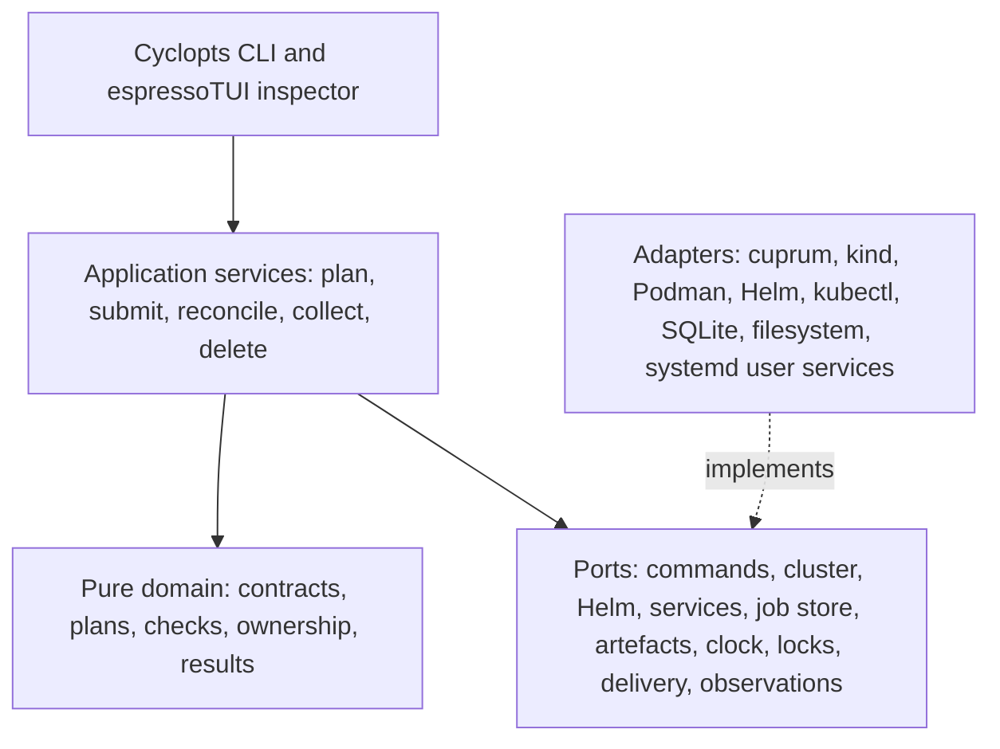
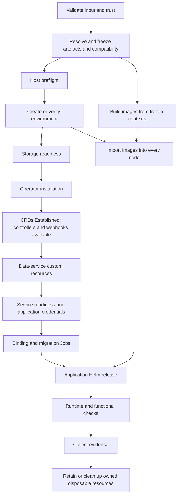
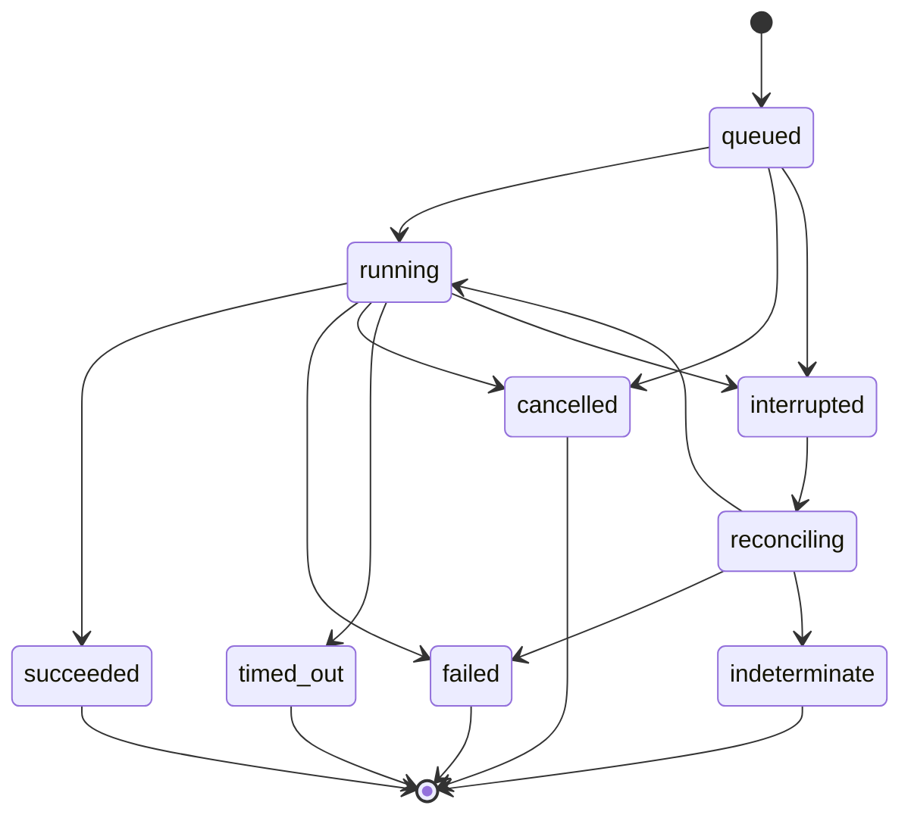

# Khufu design: shared local validation for the df12 estate

- **Status:** Draft v0.1. Revision 2 of the originating design, restructured
  for the repository. No part of Khufu is implemented yet.
- **Last substantive revision:** 2026-10-17
- **Scope:** The `khufu` command-line interface (CLI), its Python package, its
  packaged platform bundle, and the contracts consumers use to validate
  applications locally.
- **Primary audience:** Khufu implementers, consumer-repository maintainers,
  and reviewers of the extraction.
- **Precedence:** [Terms of reference](terms-of-reference.md) settle the
  problem and scope; [context](context.md) defines vocabulary; accepted
  architectural decision records (ADRs) override this document where they
  conflict. The [roadmap](roadmap.md) sequences delivery.
- **Implementation stack:** CPython 3.14, cuprum, femtologging, espressoTUI,
  and Cyclopts.

## 1. Problem and decision

Four df12 applications — Episodic, Corbusier, Wildside, and Ghillie — each
carry their own local Kubernetes preview implementation. The implementations
differ in cluster provider (k3d or kind), container engine (Docker or rootless
Podman), operator installation, credential handling, and readiness logic. Every
fix lands four times or, more often, once. The result is drift: four subtly
different answers to the question "does this application work against its
dependencies?"

Khufu replaces those implementations with one. It uses Episodic's established
kind on rootless Podman execution path as the operational baseline and
Corbusier's operator-hosting model for local data services.[^1] Khufu accepts
declarative application contracts, prepares an isolated kind environment,
installs a shared operator bundle through Helm, deploys each application's
existing chart, executes explicit checks, and produces a recoverable job record
and an evidence bundle.

The extraction preserves demonstrated behaviour before introducing
improvements. Capturing command traces, exact artefact versions, and regression
fixtures records the working baseline; it does not reopen the choice of kind or
the feasibility of rootless Podman. The combined implementation still needs
integration tests, especially where Episodic's database bootstrap moves to the
shared CloudNativePG (CNPG) path.

Khufu is not a fifth preview script, does not invoke the four existing scripts
as permanent adapters, and does not make its terminal user interface (TUI) the
execution engine. Application repositories retain their images, charts, runtime
configuration, and behavioural checks. Khufu owns cluster lifecycle, image
transport, dependency provisioning, connection binding, execution policy, and
validation evidence.

### 1.1. Implementation home

The originating design placed Khufu inside `leynos/nile-valley`. This design
proposes `leynos/khufu` as the implementation home instead, so that Khufu ships
as its own Python package and release. The proposal remains provisional until
ADR 0001 is accepted (see §18 and
[roadmap task 1.1.1](roadmap.md#11-ratify-the-decisions-that-would-otherwise-force-rework)).
Nile Valley keeps the estate manifest (`validation-estate.toml`), the
regression matrix, and the shared typed fixture specifications that its GitOps
path also renders.

## 2. Constraints and non-goals

The following constraints are non-negotiable; later sections assume them.

- **Fixed substrate.** The supported execution stack is Linux, rootless
  Podman, kind, kubectl, and Helm. kind is fixed, not a default selected from a
  provider matrix. There is no `--provider` or `--engine` option, no k3d or
  Docker implementation, no rootful fallback, and no alternate-cluster plug-in
  interface. Test doubles isolate effects without introducing production
  backend extensibility. When the stack is unavailable, `khufu doctor` reports
  the prerequisite failure.
- **No legacy compatibility targets.** Historical k3d and Docker paths appear
  only in the extraction inventory (§3.1). Khufu never wraps a legacy helper.
- **Local only.** Khufu does not create cloud resources, publish GitOps
  changes, alter real DNS, or require production credentials.
- **No umbrella chart and no operator.** Khufu owns narrow, typed data-service
  renderers. It does not absorb the four application charts into one chart and
  does not reconcile resources itself; existing operators reconcile, and Khufu
  sequences work, verifies conditions, and records evidence.
- **Headless first.** The ten agent-native guarantees (§10) belong to the
  initial headless contract. The TUI is an optional observer added later.

Non-goals, with redirects:

- Cloud-provisioning fidelity is out of scope; Nile Valley's ephemeral preview
  environments provide it.
- High availability, failover across failure domains, backups, and restore are
  untested in the minimum environment and appear as coverage exclusions unless
  an extension suite runs them (§12.1).
- Local Flux, Transport Layer Security (TLS), and External Secrets Operator
  (ESO) suites are separately scoped extensions. They must not delay extraction
  of the shared validation path.

## 3. Extraction source estate

### 3.1. Inventory

The inventory below retains observations from the first design pass at the
named commits. It is not a fresh inspection and does not claim that every
current branch matches those snapshots. Older source-level hazards are
regression cases to resolve against the baseline selected for extraction.

| Repository and snapshot | Observed local contract                                                                                                                                                                                                             | Extraction and migration                                                                                                                                                                                                                                                                               |
| ----------------------- | ----------------------------------------------------------------------------------------------------------------------------------------------------------------------------------------------------------------------------------- | ------------------------------------------------------------------------------------------------------------------------------------------------------------------------------------------------------------------------------------------------------------------------------------------------------ |
| Wildside `9f4baf0b`     | `deploy/charts/wildside`, `values.local.yaml`, `deploy/docker/backend.Dockerfile`; Docker/k3d and Podman/kind paths; generated session-key Secret; separate liveness and readiness endpoints; kind uses port forwarding.[^2]        | Preserve the session-key file mount, create-once key behaviour, qualified image naming, and unique image archives. Do not add PostgreSQL or Valkey to its minimum preview merely because other applications use them.                                                                                  |
| Episodic `baa4d21a`     | `charts/episodic`, local values, Cyclopts helper; Docker/k3d and Podman/kind; a handwritten PostgreSQL StatefulSet and Service; `DATABASE_URL`; database-aware readiness. Its local object store uses `/tmp` on `emptyDir`.[^3][^4] | Extract the rootless lifecycle, image transport, Helm deployment, and validation sequence first. Integrate CNPG hosting as a separate tested change, preserving bootstrap semantics, writable mounts, and application configuration. Keep object-store persistence an explicit application capability. |
| Corbusier `613f23b3`    | `charts/corbusier`, local values, Docker/k3d, Plumbum helpers, CNPG and Hyperspike Valkey installation; `DATABASE_URL` and `VALKEY_URL` assembled into an application Secret.[^5][^6][^7][^8]                                       | Use its operator-hosting and connection-binding model on the one kind/rootless path extracted from Episodic. Do not carry over its cluster implementation. Preserve its chart contract and client URI requirements.                                                                                    |
| Ghillie `494d7c8e`      | `charts/ghillie`, `tests/helm/fixtures/values_local.yaml`, Docker/k3d, subprocess helpers, CNPG and Hyperspike Valkey; the chart reads `secrets.existingSecretName` and imports that Secret with `envFrom`.[^9][^10][^11][^12]      | Preserve the nested chart binding rather than assuming identical values across charts. Correct and validate runtime configuration, driver packaging, and domain-operation checks before calling the application fully validated.                                                                       |
| Nile Valley `c87163b6`  | Shared ephemeral infrastructure, OpenTofu provisioning, rendered platform fixtures, and Flux reconciliation; Helm plus Kustomize is the selected packaging direction.[^13][^14]                                                     | Hosts the estate manifest and regression matrix. Shares typed fixture specifications and rendering with the GitOps path. Local validation never requires a cloud apply.                                                                                                                                |

_Table 1: Source estate inventory and extraction treatment._

### 3.2. Hazards the contract must expose

**Valkey resource identity is inconsistent.** Ghillie and Corbusier select the
Hyperspike chart but emit `apiVersion: valkey.io/v1alpha1`, `kind: Valkey`. The
upstream Hyperspike example uses `hyperspike.io/v1`, and its type definition
distinguishes primary shards (`nodes`) from replicas, documenting a current
limitation in replica behaviour.[^15][^16] A generic `replicas = 1` assumption
establishes neither topology nor high availability.

**A passing health endpoint can conceal missing functionality.** Ghillie's
helper writes `DATABASE_URL`, but its runtime checks `GHILLIE_DATABASE_URL`
before enabling domain endpoints, and its chart imports Secret keys without
renaming them.[^17] Its runtime dependency list places `asyncpg` in the
development group, and its Dockerfile installs the wheel without that
group.[^18][^19] These are source-level findings, not a reproduced runtime
failure; they require a packaged-image test and an application change, not a
renamed CLI option.

**Kubernetes compatibility constrains the preview.** Wildside's chart declares
`>=1.26.0-0 <1.32.0-0` and its helper pins kind's node image accordingly. A
modern operator bundle cannot inherit that node image, and Khufu cannot bypass
the chart constraint. Khufu resolves the compatibility intersection and fails
when it is empty (§7.1).

**Credential encoding and image naming need contract tests.** Corbusier
percent-encodes its cache password and uses `redis://`; Ghillie's helper
interpolates a password into `valkey://`. The correct scheme belongs to the
client contract (§6.2). Wildside already handles the discrepancy between
Podman's short-name tagging and Kubernetes image-name resolution (§8.4).

**Ingress cannot rely on catch-all defaults.** Ghillie's local values use an
empty ingress host. When applications share one environment, the planner
generates distinct hostnames and explicit ingress classes or rejects ambiguous
routes (§8.5).

## 4. Scope, ownership, and anti-drift invariants

### 4.1. Ownership model

Khufu operates on five entities, defined in [context](context.md): an
application, an environment, a plan, a job, and a report. A report records
checks and evidence independently of whether its environment still exists.

Each environment is a dedicated kind cluster. One environment may host several
applications that share operator installations, but never their database users,
application Secrets, or data-service instances by default. Independent
worktrees receive distinct environment identities. Reusing an environment
requires an explicit environment ID and a compatible platform fingerprint;
matching a cluster's display name is insufficient.

Cluster-scoped operators and custom resource definitions (CRDs) belong to the
environment. Application namespaces, application releases, data-service custom
resources, and test Jobs belong to application instances. The ledger records
the executor of every top-level resource, and direct Helm execution and Flux
never reconcile the same release.

### 4.2. Anti-drift invariants

Khufu maintains exactly one implementation of each of: rootless preflight, kind
lifecycle, private kubeconfig handling, image build and import, Helm
invocation, operator installation, custom-resource rendering, readiness
predicates, credential binding, evidence collection, and cleanup. After
migration, none of these lives in a consumer repository.

Consumers own images, charts, application-only values, dependency requirements,
schema migrations, and behavioural checks. They may request a PostgreSQL
database or a Redis-compatible cache and declare storage and client
requirements. They may not select operator charts, pin controller images,
supply arbitrary infrastructure manifests, override kind configuration, replace
readiness algorithms, or define infrastructure lifecycle hooks. Schema
validation rejects those fields (§6.2). A genuine shared-infrastructure
enhancement changes Khufu and passes the regression matrix.

Each Khufu release packages one authoritative platform lock with its operator
manifests and schemas (§7.1). Named central profiles may alter tested resource
budgets or opt into additional capabilities; they cannot replace the substrate
or fork the platform implementation.

Consumer Make targets survive only as thin delegates with explicit legacy
variable translation during migration. They may select an application and an
operation but may not run kind, Podman, Helm, or kubectl, install fallback
operators, copy shared Python modules, or render platform YAML. Central
continuous integration (CI) enforces this with contract tests and scoped
repository checks that distinguish legacy orchestration from legitimate
application tests and documentation.

### 4.3. Estate pinning

Nile Valley's estate manifest records the approved Khufu toolchain and the
consumer revisions used by the regression matrix. Workspaces use an exact
toolchain pin. Where consumer CI needs a bootstrap pin, it is generated from or
checked against the estate manifest. Floating versions and per-consumer
installs with unrelated dependency resolution are rejected.

A shared implementation alone does not eliminate version drift. Central CI
compares consumer pins, contract schema versions, and platform fingerprints,
and exercises shared infrastructure changes against all four application
contracts. Ordinary local validation uses the pinned workspace and cached
metadata and never contacts GitHub to discover a moving version. Testing a
candidate toolchain requires an explicit local selection, and the report
records that identity.

## 5. Architecture

### 5.1. Layering

Khufu follows a hexagonal layering in which dependencies point inwards towards
a pure domain.

For screen readers: the following diagram shows five layers from the CLI and
TUI at the top to adapters at the bottom, with each layer depending only on the
layer beneath it, and adapters implementing ports.



_Figure 1: Khufu layering and dependency direction._

The domain computes plans and legal state transitions. It has no dependency on
terminal rendering, subprocesses, Kubernetes clients, or logging. The
application layer sequences effects through an explicit directed acyclic graph
(DAG) and handles reconciliation and compensation. Adapters implement
mechanisms without deciding application policy, so a test can substitute every
port without a production plug-in interface.

### 5.2. Package layout

The package lives at `khufu/` in this repository, following the existing
project template rather than the `src/` layout sketched in the originating
design.

```plaintext
khufu/
  domain/          # Contract, Plan, Step, Check, Result, ownership rules
  application/     # plan, submit, reconcile, collect, delete
  ports/           # typed Protocol boundaries
  adapters/
    commands/      # cuprum catalogue and typed command builders
    cluster/       # the fixed kind/rootless Podman implementation
    helm/          # lock-aware direct Helm execution
    services/      # CNPG, Hyperspike Valkey, secret bindings
    jobs/          # SQLite ledger and worker supervision
    artefacts/     # bounded collection, redaction, atomic delivery
  cli/             # Cyclopts registration and command descriptors
  tui/             # espresso models, messages, update and views
  schemas/         # versioned contract, plan, result, and context schemas
  platform/        # platform.lock.toml, operator manifests, CRD schemas
  skills/          # generated and validated agent workflow guidance
```

The `cluster` adapter contains one implementation. It is a module, not a
registry.

### 5.3. Required libraries

**Cyclopts** provides typed command parsing, help, and dispatch.[^20] A
Khufu-owned command descriptor adds effect classification, schemas, enum sets,
asynchronous behaviour, and examples. CLI registration and `agent-context` are
generated from the same descriptors, and CI validates skill examples against
the generated surface. Khufu adapts Cyclopts parsing exceptions before Cyclopts
prints its default presentation or exits, so malformed invocations honour the
machine protocol (§10).

**cuprum** is the sole external-command execution boundary.[^21] Khufu uses its
approved-program catalogue, argument-vector builders, structured results,
asynchronous runtime, and bounded concurrency. There is no public arbitrary
`exec` escape hatch. A catalogue entry permitting `kubectl` is not a policy for
every kubectl subcommand; typed builders and target validation (§8.3) enforce
that. cuprum's child cancellation does not by itself prove whole-process-tree
cleanup or rollback of accepted Kubernetes actions, so supervisor and
reconciliation tests verify both (§11).

**femtologging** handles diagnostic logging behind a narrow adapter.[^22] Khufu
serializes its own redacted event objects before handing messages to handlers
when the selected femtologging version lacks a suitable structured-field API,
and assumes no Journald or OpenTelemetry integration. The SQLite ledger, not an
asynchronous logging queue, records correctness-critical transitions. A logging
failure never produces a successful validation result.

**espressoTUI**, imported as `espresso`, implements the optional
dashboard.[^23] Its model/update/view structure consumes the same versioned
observations as machine clients, and its `Cmd` effects call application
services rather than shelling out. The TUI offers a run list, step progress, a
bounded log viewport, check details, and an artefact browser. It has no
TUI-only operation or mandatory wizard. Closing it detaches the observer;
cancellation remains a separate explicit operation. Khufu imports the TUI
lazily so machine execution never initializes a terminal.

### 5.4. Python runtime qualification

Khufu targets ordinary CPython 3.14. The lockfile pins exact package versions
and distribution hashes; minimum-version metadata is not evidence of
compatibility. Qualification covers imports, command execution, cancellation,
terminal restoration, and logging shutdown on the supported platforms. Normal
installations consume a published femtologging wheel rather than compiling a
Rust toolchain on each validation run. cuprum's optional acceleration is not a
correctness prerequisite.

## 6. Configuration and application contracts

### 6.1. Inputs and precedence

Khufu reads three distinct inputs:

1. `.khufu.toml` in a consumer repository: the application contract.
2. `khufu.workspace.toml`: application IDs mapped to local checkouts and an
   exact Khufu toolchain selection. The packaged platform bundle supplies
   infrastructure versions.
3. A named user profile: host preferences, execution budgets, and delivery
   policy.

Relative application paths resolve from the consumer repository root, not the
caller's working directory. The workspace may name sibling repositories, but an
application contract cannot escape its own root. Discovery is read-only and
never imports application Python modules or runs hooks. Unknown fields and
unknown schema versions fail with JSON Pointer field locations and the valid
alternatives.

Precedence, highest first, is: explicit flags, `KHUFU_*` environment variables,
the selected profile, the workspace, the application contract, and packaged
defaults. The platform lock is a hard compatibility constraint, not a layer in
that order. A credential reference is never a plaintext profile value.

### 6.2. Application contract schema

The following illustrative Corbusier contract shows the proposed schema version
1.

```toml
schema_version = 1
application = "corbusier"

[image]
context = "."
dockerfile = "Dockerfile"

[chart]
path = "charts/corbusier"
values = ["charts/corbusier/values.local.yaml"]

[chart.bindings]
image_repository = "image.repository"
image_tag = "image.tag"
image_pull_policy = "image.pullPolicy"
application_secret = "existingSecretName"

[services.postgres]
database = "corbusier"
owner = "corbusier"
instances = 1
storage = "1Gi"

[services.cache]
client_protocol = "redis"
topology = "single-primary"

[environment.DATABASE_URL]
source = "postgres.application-uri"
codec = "postgresql-uri"

[environment.VALKEY_URL]
source = "cache.application-uri"
codec = "redis-uri"
```

A `postgres` declaration always uses Khufu's CNPG implementation (§7.2), and a
`cache` declaration always uses its Valkey implementation (§7.3). The
application neither chooses nor versions them. `single-primary` expresses a
client requirement, not a custom-resource field; the renderer does not
translate it mechanically into `replicas: 1`, and integration tests verify the
locked resource shape against the application's real client.

Contracts also declare health endpoints, connection-Secret bindings,
migrations, fixture loading, functional checks, ingress bindings, expected
writable paths, and persistence requirements. The schema rejects every field
listed as consumer-forbidden in §4.2.

Ghillie's contract binds `GHILLIE_DATABASE_URL` for its current runtime and
selects a URI codec compatible with the asynchronous driver packaged in its
image. Promoting that driver into the runtime image is an application change;
Khufu never conceals it by installing a host package.

### 6.3. Checks and trust

A check has an ID, category, dependencies, executor, finite deadline, required
or optional status, result schema, and expected artefacts. Checks normally run
as Kubernetes Jobs using the application image or a separately pinned test
image, with credentials supplied through Secret references.

An application-owned host test entrypoint requires explicit trust authorization
in the reviewed plan and runs through cuprum without a shell. Host entrypoints
perform migrations, fixtures, or assertions only; they never provision or tear
down infrastructure. Host execution is trusted code, not a sandbox, so
repository checks and review enforce that boundary. No template expression
evaluates arbitrary Python.

## 7. Platform bundle

### 7.1. Lock and qualification

Every environment uses the platform lock packaged with the selected Khufu
release. The lock covers kind, the Kubernetes node image and digest, supported
rootless Podman versions, the Helm version, kubectl compatibility, the storage
provisioner, operator chart artefacts and digests, controller images, CRD
schemas, PostgreSQL and Valkey images, and any explicitly supported optional
components such as Traefik. Applications cannot overlay the lock.

The initial lock and golden-path tests are seeded from the working Episodic
setup and Corbusier's operator configuration and verified as one
implementation. Where an older inspected source differs from the demonstrated
environment, Khufu records and tests the actual baseline rather than copying
the older configuration.

The lock stores a reference to its qualification evidence; version labels alone
do not imply a tested combination. Rendering uses the locked Kubernetes version
and exact CRD schemas. Missing schema coverage for a required resource is a
failed contract check. Before a bundle becomes supported, both a cold
installation and an existing-environment reconciliation pass.

Planning computes the intersection of every selected chart's `kubeVersion`
constraint with the locked node image. An empty intersection is a planning
error that names the conflicting constraints. Khufu never bypasses a chart
constraint; widening a chart's range is an application change justified by
tests.

### 7.2. CNPG

Khufu installs the CNPG operator once per environment from its upstream Helm
chart and gives each application its own CNPG cluster and application user. The
small local profile uses one database instance and marks high availability,
failover, backups, and restore as untested coverage exclusions.

Bindings read the application connection Secret, never a superuser credential,
and target the managed service endpoint rather than a Pod IP.[^24] Direct
Secret-key references are preferred where the chart can express them. Where a
consolidated application Secret or URI conversion is necessary, a typed binding
step records the source Secret identity and resource version without its
contents. Reconciliation detects source changes and refreshes the binding and
workload deliberately.

### 7.3. Valkey

The platform bundle keeps the implementation identity `hyperspike-valkey`
because the inspected operator-based helpers select it. It is an internal,
centrally owned choice. Changing operator requires one Khufu platform change,
compatibility tests, and migration, never a per-repository substitution.

Qualification covers the exact chart source, CRD group and version,
authentication Secret, topology, service selection, storage, optional
certificate dependencies, and client URI shape. Tests run an authenticated
`PING`, a uniquely namespaced write/read/delete sequence, and the application's
relevant multi-key or transaction behaviour. Single-primary and clustered
Redis-compatible endpoints are different client contracts.

When the shared implementation cannot satisfy a declared client or topology
requirement, Khufu returns a capability error before deployment, for example
`UNSUPPORTED_SERVICE_TOPOLOGY` (§10.2). It never substitutes a raw StatefulSet,
anonymous authentication, or an unrelated chart.

### 7.4. Reconciliation order

Every environment-mutating job executes the same core DAG.

For screen readers: the following flowchart shows the ordered reconciliation
steps from input validation to cleanup, with image builds running in parallel
with cluster preparation and joining before the application release.



_Figure 2: Core reconciliation DAG._

Readiness predicates require non-empty expected resource sets, service
endpoints, and provider-specific conditions, and compare observed generation
where the resource exposes it. A selector that matches no Pods never passes.
Khufu does not treat `helm --wait` as proof that an operator has reconciled its
custom resources.

Helm's CRD lifecycle and dry-run limitations need explicit handling.[^25]
`--dry-run` computes proposed effects without installing operators. A real
server-admission check belongs to an explicitly provisioned disposable
environment. CRD upgrades belong to an explicit platform-upgrade plan or to
environment recreation, never to an ordinary application refresh.

## 8. Cluster substrate and connectivity

### 8.1. Host preflight

`khufu doctor` checks executable availability and versions, the rootless user
ID, Podman connection locality, cgroup v2 and delegation, user-systemd
availability, subordinate-ID mappings, writable runtime, state, and cache
directories, disk headroom, storage support, and networking prerequisites. It
records findings with supported values and specific remediation. It never runs
`sudo`, changes sysctls, edits global container configuration, or switches to
rootful containers.

Rootless kind has documented cgroup, delegation, PID, inotify,
kernel-networking, and log-driver hazards.[^26] `doctor` classifies actual host
observations rather than inferring readiness from a distribution version. Khufu
uses a per-invocation container-configuration overlay where supported; any
host-level fix remains an explicit user action.

### 8.2. kind on rootless Podman

Khufu sets `KIND_EXPERIMENTAL_PROVIDER=podman` in the controlled command
environment and uses a delegated user scope for cluster creation where
required. The environment fingerprint includes the effective cluster
configuration and the qualified node image digest.

### 8.3. Kubeconfig and target identity

Each environment has a private kubeconfig with mode `0600`. Every Kubernetes
and Helm operation receives its path and an explicit context; Khufu never
merges into or changes `~/.kube/config`. Before any mutation, Khufu verifies
the provider node container identity, the API-server certificate authority (CA)
fingerprint, and the recorded environment marker UID. Name prefixes are a
convenience, not an authorization.

### 8.4. Image build and transport

Local application images use fully qualified names with unique build tags.
Build identity covers the staged build context including uncommitted and
untracked inputs, the Dockerfile, build parameters, and platform. Khufu records
the resulting image ID or Open Container Initiative (OCI) digest separately. An
asynchronous job builds from a frozen build context or detects changes before
execution; a Git SHA alone is not provenance for a dirty worktree.

Podman builds and exports an archive to a unique temporary path; kind imports
it into every scheduled node. The chart references exactly that qualified name
and tag. Khufu removes temporary archives on success, failure, and
cancellation, and records import results. Pull policy is `Never` for proven
imported images where the chart allows it, otherwise an explicitly verified
non-stale policy. A failed import never falls back to pulling a different image.

### 8.5. Connectivity and ingress

Default connectivity is supervised, loopback-only port forwarding on allocated
high ports. Khufu records the target resource and bound port only after the
listener starts. This avoids fixed host-port collisions and never modifies
`/etc/hosts`.

The optional `ingress` capability installs the locked Traefik release with
explicit per-application hosts and ingress classes. Ingress checks run through
a loopback forward to Traefik with the appropriate `Host` header, separately
from direct service checks. When ingress is not requested, the report records
`not_requested` coverage rather than implying that ingress works.

### 8.6. Resource budgets

No pre-flight capacity check can guarantee that a run fits. Khufu starts with
one concurrent image build, one concurrent cluster creation, and a small
bounded pool for I/O-bound commands. Profiles declare CPU, memory, disk, and
deadline budgets. Plans report conservative estimates and observations without
presenting them as measured performance guarantees.

## 9. Command surface

Commands follow `khufu <resource> <verb>` with no `local` prefix. Top-level
help stays compact, and `get`, `list`, `create`, `update`, and `delete` mean
the same thing wherever they apply.

| Command                                                           | Contract                                                                                                              |
| ----------------------------------------------------------------- | --------------------------------------------------------------------------------------------------------------------- |
| `khufu doctor`                                                    | Read-only prerequisite report.                                                                                        |
| `khufu app list` / `get`                                          | Discover application contracts and capabilities without running them.                                                 |
| `khufu plan create` / `get`                                       | Compute and optionally persist a typed, redacted plan.                                                                |
| `khufu environment create` / `update` / `get` / `list` / `delete` | Explicit environment lifecycle. Mutations submit jobs.                                                                |
| `khufu run create`                                                | Submit a validation job from a frozen plan. Creates a disposable environment unless the plan selects an existing one. |
| `khufu jobs get` / `list` / `cancel` / `resume` / `prune`         | Inspect, reattach, cancel, or recover jobs. Pruning removes records, never clusters.                                  |
| `khufu logs get`                                                  | Bounded, redacted logs for a job, step, or resource.                                                                  |
| `khufu report get`                                                | Structured check report and artefact references.                                                                      |
| `khufu endpoint create` / `get` / `list` / `delete`               | Supervised loopback forwarding attached to a known environment.                                                       |
| `khufu profile create` / `update` / `get` / `list` / `delete`     | Persistent host configuration, never plaintext credentials.                                                           |
| `khufu feedback create` / `get` / `list`                          | Local friction reports with optional job or command references.                                                       |
| `khufu agent-context`                                             | Versioned, filterable, machine-readable command and capability metadata.                                              |
| `khufu skill-path`                                                | Location of the packaged workflow skill.                                                                              |
| `khufu tui`                                                       | Optional espressoTUI observer and command client.                                                                     |

_Table 2: Proposed canonical command surface._

The compact validation workflow takes two calls. Identifiers are illustrative.

```bash
khufu plan create --app ghillie --suite smoke --json
khufu run create --plan plan_7e4c \
  --idempotency-key ghillie-pr-42-smoke --wait --json
```

`plan create` pins sources and effects. `run create` rejects a stale or
incompatible plan rather than replanning under an approved ID.

Recovery and deliberate deletion use:

```bash
khufu jobs get job_93bd --wait --wait-timeout 60s --json
khufu logs get --job job_93bd --step application-check --limit 100 --json
khufu report get report_93bd --deliver file:./validation-report.json --json
khufu environment delete env_5c9a --dry-run --json
khufu environment delete env_5c9a --force --allow-data-loss --wait --json
```

The delete plan determines whether `--allow-data-loss` is required. `--force`
authorizes deletion without prompting but never bypasses ownership, credential
policy, compatibility, or target checks. A disposable run authorizes cleanup of
its own synthetic environment only.

Every submitting mutation supports `--wait`, a finite execution `--timeout`,
`--idempotency-key`, `--dry-run`, and `--json`. `--wait-timeout` bounds the
observer only and never cancels an in-flight job. `jobs get` succeeds when it
retrieves a job, even a failed one; `jobs get --wait` and `run create --wait`
propagate the job's terminal outcome.

## 10. Agent-native protocol

### 10.1. Principles

Khufu implements each of the ten principles for agent-native CLIs
explicitly.[^27] JSON output alone does not satisfy them.

| Principle                               | Khufu contract                                                                                                                                                                                                      |
| --------------------------------------- | ------------------------------------------------------------------------------------------------------------------------------------------------------------------------------------------------------------------- |
| 1. Non-interactive by default           | No ordinary command prompts. Missing inputs fail before side effects. `--no-input` is accepted everywhere as an explicit assertion. Only `tui` requests a terminal.                                                 |
| 2. Structured, parseable output         | Uniform `--json`; JSON is the non-TTY default. Results go to stdout, machine-mode errors to stderr with stable codes. No child output or ANSI sequences contaminate the result stream.                              |
| 3. Errors that teach and enumerate      | Stable error code, field, received value, allowed set, retryability, job and step identity, and suggested argument vector. Sensitive received values are redacted.                                                  |
| 4. Safe retries and mutation boundaries | Durable idempotency keys, natural resource identities, frozen plan hashes, explicit deletion authorization, and mutation-free dry runs.                                                                             |
| 5. Bounded responses                    | Lists default to 20 entries, maximum 200. Logs default to 100 lines with an aggregate byte limit. Summary JSON is capped structurally at 64 KiB with artefact or cursor continuation; JSON is never byte-truncated. |
| 6. Vocabulary consistency               | The descriptor registry rejects banned aliases and inconsistent flags in CI.                                                                                                                                        |
| 7. Three-layer introspection            | Human `--help`, versioned and filterable `agent-context`, and workflow-oriented `SKILL.md`, kept synchronized by generation and validated examples.                                                                 |
| 8. Async-aware execution                | Durable submission, optional bounded waiting, reconnectable observation, explicit cancellation, and crash reconciliation.                                                                                           |
| 9. Persistent profiles                  | Discoverable profile names, documented precedence, and value provenance; no secrets in profiles or introspection.                                                                                                   |
| 10. Two-way input and output            | Atomic file delivery, structured stdout delivery, and local feedback records. Upstream delivery is an explicit, separately authorized adapter, never automatic telemetry.                                           |

_Table 3: Agent-native principles and Khufu contracts._

### 10.2. Envelopes

Every machine-mode success shares a stable outer shape. Values below are
illustrative.

```json
{
  "schema_version": "1.0",
  "command": "run.create",
  "request_id": "req_671d",
  "status": "succeeded",
  "job_id": "job_93bd",
  "environment_id": "env_5c9a",
  "result": {
    "plan_id": "plan_7e4c",
    "report_id": "report_93bd",
    "checks": {"passed": 12, "failed": 0, "skipped": 0},
    "coverage": ["render", "deployment", "dependencies", "application-smoke"]
  },
  "artifacts": [],
  "warnings": [],
  "truncated": false,
  "next_cursor": null
}
```

Submission without waiting returns `status: accepted`, not `succeeded`. Reports
distinguish `passed`, `failed`, `blocked`, `skipped`, and `not_requested`, and
a required check cannot skip its way to success. Every report records the Khufu
release, platform lock digest, contract schema version, and application source
fingerprint, so different toolchains cannot masquerade as equivalent validation.

Errors use the same versioned envelope:

```json
{
  "schema_version": "1.0",
  "status": "error",
  "error": {
    "code": "UNSUPPORTED_SERVICE_TOPOLOGY",
    "field": "/services/cache/topology",
    "received": "sentinel",
    "allowed": ["single-primary"],
    "retryable": false,
    "message": "Only single-primary cache clients are supported by this platform bundle."
  }
}
```

### 10.3. Exit codes

| Code  | Meaning                                                     |
| ----- | ----------------------------------------------------------- |
| `0`   | Successful request or submission.                           |
| `2`   | Invalid input.                                              |
| `3`   | Host prerequisite failure.                                  |
| `4`   | Missing resource.                                           |
| `5`   | Conflict or stale plan.                                     |
| `6`   | Policy refusal.                                             |
| `7`   | Execution or infrastructure failure.                        |
| `8`   | Failed validation checks.                                   |
| `9`   | Deadline or observer wait expiry.                           |
| `10`  | Interrupted or indeterminate work.                          |
| `70`  | Internal defect.                                            |
| `130` | Client interrupted by SIGINT; the durable worker continues. |

_Table 4: Exit code taxonomy._

The JSON error code carries the precise category; the exit code is a coarse
classification for shells.

### 10.4. Output channels

In machine mode, successful stdout contains exactly one JSON document, and a
failure emits one structured error document. Incidental stderr chatter is
suppressed; diagnostics and progress remain available through job artefacts and
bounded event queries. In human mode, stdout carries static summaries and
stderr carries progress. The TUI owns its own terminal session and never shares
the machine result channel.

### 10.5. Agent context

`agent-context` returns a bounded index by default: schema versions, command
names, effect classes, available profiles, and application IDs. `--command`,
`--application`, and `--detail` expand individual contracts. Metadata covers
local-state writes, cluster writes, destructive effects, execution and network
requirements, valid enums, idempotency semantics, and examples. It never loads
every chart value or Secret path into an agent's context.

## 11. Durable jobs and concurrency

### 11.1. Ledger

The ledger lives under `$XDG_STATE_HOME/khufu`, falling back to
`~/.local/state/khufu`. It uses SQLite transactions, foreign keys, and
write-ahead logging (WAL) on a supported local filesystem, never on a network
filesystem or inside a repository. Profiles live under XDG config, reusable
immutable artefacts under XDG cache, and short-lived sockets and locks under
XDG runtime storage.

The ledger stores environments, plans, jobs, steps, resource inventories,
idempotency keys, events, and artefact references. It never stores secret
values or credential-bearing command input. Large bounded logs and reports live
in protected files, not unbounded rows.

### 11.2. Submission and idempotency

Submission transactionally creates or finds a job by its scope-qualified
idempotency key. Reusing a key with a different plan hash is a conflict (exit
`5`).

### 11.3. Supervision

On rootless Linux, each long operation runs in a named transient systemd user
service with a stable, locked Python environment. Khufu commits the job before
starting its worker, then records and verifies the unit identity. If Khufu
crashes between commit and start, recovery reconciles the recorded unit name
instead of spawning a second worker. The user service owns execution; a TTY or
`--wait` process only observes.

User services are not assumed to survive logout or reboot, and `doctor` reports
the host's session guarantees. After a reboot the ledger remains durable while
execution has stopped; recovery marks the job interrupted and reconciles it. A
foreground CI mode serves hosts without a usable systemd user session. It
records foreground execution in the job and report, advertises that losing its
process interrupts execution, and never masquerades as detached execution.

### 11.4. Job state machine

For screen readers: the following state diagram shows a job moving from queued
to running and then to one of four terminal states, or through interrupted and
reconciling back to running or to a failed or indeterminate terminal state. A
queued job can also be cancelled before it starts, or become interrupted when a
crash leaves its worker start unconfirmed.



_Figure 3: Job state machine._

Each step records intent before its external effect and the observed outcome
afterwards. Every executable step supplies an observer and an explicit retry
and recovery classification. After a crash, Khufu re-queries kind, Kubernetes,
and Helm rather than assuming an operation failed because the client lost its
response. An application migration or fixture without safe replay semantics may
end `indeterminate` and require deliberate recovery. Khufu makes no
exactly-once claim.

### 11.5. Cancellation

Cancelling a queued job whose worker has not started moves it directly to
`cancelled`. If the worker start is unconfirmed, recovery first reconciles the
recorded unit name (§11.3) and stops any worker it finds.

For a running job, `jobs cancel` records the request durably, stops supervised
subprocess groups with a bounded grace period, then reconciles resources
Kubernetes has already accepted, stopping owned test Jobs where necessary.
Cancellation is not rollback. Whether the environment is retained or deleted
follows the job's cleanup policy (§14).

### 11.6. Locking

A worker holds an operating-system-backed per-environment mutation lock for the
whole of a state-sensitive validation run, so no other job can replace an
image, mutate a Secret, or migrate a database mid-check. The ledger alone does
not prevent concurrent Helm actions. Read-only observations never take the
mutation lock. Builds may run outside the lock because they consume immutable
snapshots. Independent concurrency is bounded centrally (§8.6) rather than per
subcommand.

## 12. Validation suites and coverage

### 12.1. Suites

**Contract suite.** Parses schemas; resolves required files; verifies lock and
chart dependency hashes; runs Helm lint and deterministic rendering; validates
against exact Kubernetes and CRD schemas; and checks namespace scope, Secret
bindings, image references, probes, volume requirements, and requested
capabilities. It needs no running cluster. Missing cached artefacts produce an
actionable error in offline mode; validation never silently resolves a new
version.

**Smoke suite.** Creates or verifies the rootless kind environment, installs
selected operators, proves service connectivity and authentication from inside
the cluster, runs declared migrations, deploys the built image, checks liveness
and readiness, and runs at least one non-health application operation. A
database `SELECT 1` is not evidence that schema and business operations work.

**Integration suite.** Executes application-owned, deterministic acceptance
scenarios with local dependency fakes and synthetic credentials. A live AI
provider or other external service requires an explicit profile capability and
appears as a distinct coverage mode; the default never spends API credits or
contacts production systems. A missing declared functional test blocks the
corresponding validation level.

**GitOps suite (deferred).** Renders from the same typed platform and
application specifications, delivers manifests and chart artefacts through a
local source accessible to Flux, and lets Flux own those releases. It waits for
source, Kustomization, and HelmRelease reconciliation against the recorded
source revision. Direct-Helm success never counts as Flux success, and a local
Git or OCI fixture replaces real GitHub commits.

**Platform extension suites (deferred).** Ingress with TLS, ESO-backed Secret
delivery, storage restart persistence, database recovery, and multi-node
failover. Unsupported production properties appear as coverage exclusions.
Three Pods on one host are not evidence of resilience to host failure.

### 12.2. Consumer minimums

| Consumer  | Minimum smoke contract                                                                                                                                                                                                                 |
| --------- | -------------------------------------------------------------------------------------------------------------------------------------------------------------------------------------------------------------------------------------- |
| Wildside  | Image and chart health contract, required session-key mount, and a declared non-health operation. A no-database profile remains only where the contract allows it.                                                                     |
| Episodic  | CNPG-backed readiness, migration and schema check, a declared application operation, and explicit handling of the ephemeral source-intake object store. A persistence suite must use a persistent object store rather than `emptyDir`. |
| Corbusier | PostgreSQL and Valkey authentication and client compatibility, migrations, and a declared operation exercising the services the runtime needs.                                                                                         |
| Ghillie   | Full runtime configuration, packaged PostgreSQL driver, domain endpoint availability, and a deterministic report-domain scenario with required fixtures or fakes. A health-only profile cannot satisfy full smoke validation.          |

_Table 5: Minimum smoke contracts per consumer._

These are acceptance contracts to implement with each consumer, not claims that
the consumers already expose suitable scripts or fixtures.

## 13. Evidence, secrets, and delivery

### 13.1. Report and evidence bundle

Each report records the source revision and frozen content fingerprint, image
identities, CLI and dependency versions, platform lock hash, chart artefact and
values hashes, environment identity, executed check IDs, execution mode,
timestamps, durations, outcomes, and coverage exclusions.

An evidence bundle contains a summary, canonical report JSON, JUnit XML, the
redacted plan, relevant rendered manifests, bounded Kubernetes events, Pod
status and termination data, current and previous container logs where
available, migration and test Job results, Helm and Flux observations, and
cleanup results. Khufu collects failed Job and Pod diagnostics before TTL
cleanup, namespace deletion, or any configured rollback removes them.

The primary validation failure and any cleanup failure are both preserved; a
cleanup problem never overwrites the original error. A failed required
leak-cleanup check prevents a disposable run from succeeding.

### 13.2. Secrets

Secrets are typed sensitive values. They never appear in CLI flags, profiles,
Helm values files, the ledger, artefact names, or URLs. Khufu prefers Secret
references. When an adapter must transport a generated Secret, it uses stdin or
protected temporary storage and prevents command logging from retaining the
body. Khufu avoids client-side apply annotations that duplicate Secret
payloads, choosing an explicit server-side, create, or patch path and ownership
model. Existing generated session credentials, such as Wildside's session key,
persist unless a separate operation authorizes rotation.

### 13.3. Redaction and file safety

Redaction runs before stdout, stderr, femtologging handlers, and artefact
persistence. Structured manifests are parsed so that `data`, `stringData`,
token fields, kubeconfig client credentials, and credential-bearing URLs are
omitted. Known credential encodings are scrubbed from free-form logs, but Khufu
does not promise perfect redaction of arbitrary application output. Collectors
default to narrow scopes; a raw, unredacted bundle requires a separate,
explicit, local-only action.

Private directories are user-only and sensitive files use mode `0600`. Khufu
validates output paths, refuses to follow attacker-controlled symlinks, writes
same-directory temporary files, and renames atomically. It stores artefact
hashes and byte sizes and never trusts a path embedded in application output as
an export destination.

### 13.4. Delivery and feedback

`--deliver=stdout` returns a bounded structured report payload.
`--deliver=file:<path>` atomically writes the report or bundle and returns
metadata. Binary archives never share stdout with a JSON envelope. Unknown
schemes return the supported set. A later webhook adapter requires endpoint
allowlists, credential references, bounded timeouts, disabled cross-origin
redirects, and separate delivery idempotency; retrying delivery never reruns
validation.

Feedback is local and references command or job IDs with redacted free text.
Khufu performs no automatic telemetry, issue creation, upstream POST, or
artefact upload. A separately configured export is discoverable through
`agent-context` without disclosing its credentials.

## 14. Cleanup and ownership-aware deletion

A disposable environment defaults to retain-on-failure and delete-on-success,
after evidence collection. CI may select retain-never. A pre-existing
environment is retained unless a separate deletion operation authorizes its
destruction.

Cleanup is inventory-driven. Khufu deletes application Jobs, releases, and
custom resources while the operators they depend on are still running, waits
within deadlines for finalizers and PersistentVolumeClaim (PVC) policy, and
removes cluster-scoped components only when deleting their owning environment.
A stuck finalizer produces diagnostics, never an automatic force-removal.

Deleting a kind environment removes its node-local volumes, and the delete plan
states that data-loss consequence. Job pruning removes only terminal records
and artefacts selected by retention policy. A reported age or expiry is not a
promise of garbage collection unless a configured service performs it.

`--force` cannot authorize deleting an unrecognized or externally owned
cluster. If the ledger is lost, Khufu reports orphaned candidates and requires
an explicit adoption or recovery workflow that verifies their identity (§8.3).
Labels and display names never establish ownership.

## 15. Verification strategy

### 15.1. Invariants

The following properties define correctness. Each names its verification
mechanism.

| Invariant                                                                                                                     | Mechanism                                                                                                    |
| ----------------------------------------------------------------------------------------------------------------------------- | ------------------------------------------------------------------------------------------------------------ |
| Every job follows only the transitions in Figure 3.                                                                           | Hypothesis `RuleBasedStateMachine` over the domain transition function, with the ledger adapter in the loop. |
| The same idempotency key and plan hash yield one job; a different hash conflicts.                                             | Hypothesis stateful test over interleaved submissions, plus a two-process race test against SQLite.          |
| No mutation reaches a cluster whose kubeconfig context, CA fingerprint, node identity, or marker UID differs from the ledger. | Property test over mismatched target tuples through the command port; end-to-end test with a decoy cluster.  |
| A required check never resolves to a successful skip.                                                                         | Property test over check DAGs with arbitrary missing executables and fixtures.                               |
| Redacted outputs contain no secret canary in raw, URI-escaped, or base64 form.                                                | Canary injection through every collector, scanned across stdout, stderr, ledger, plan, logs, and bundle.     |
| Readiness never passes on an empty selector match.                                                                            | Property test over observed resource sets, including empty sets.                                             |
| Rendering is deterministic for a fixed plan.                                                                                  | Snapshot of rendered manifests per consumer contract, paired with semantic assertions.                       |
| Killing a worker at any intent, effect, or record boundary yields a safe reconciliation or `indeterminate`.                   | Fault-injection end-to-end suite that kills the worker at each recorded boundary.                            |

_Table 6: Correctness invariants and their verification mechanisms._

Unit and behavioural tests are implementation defaults and are not listed.

### 15.2. Combinatorial surface

The interaction surface is consumers (four) × suites (contract, smoke,
integration) × capabilities (none, `ingress`) × environment mode (disposable,
reused) × data services (none, `postgres`, `postgres` + `cache`). Not every
cell is meaningful: Wildside's minimum contract has no data services.

The regression matrix runs every consumer's contract suite on every change and
every consumer's smoke suite in a disposable environment on every
shared-infrastructure change. A single four-consumer coexistence run in one
reused environment, with `ingress` enabled, covers namespace, release-name,
Secret, image-tag, and route collisions. Pairwise coverage of the remaining
capability and mode axes is accepted; the untested combinations are listed in
the matrix output as coverage exclusions rather than silently omitted.

### 15.3. Release acceptance

The first consolidated release demonstrates each of the following with an
executable test. Earlier milestones may land independently but must not claim
that all four consumers have migrated.

- Episodic's demonstrated validation path runs through Khufu, and Corbusier's
  service-hosting model runs on the same kind/rootless implementation.
- All four consumers use the approved Khufu and platform baseline. CI detects
  divergent bootstrap pins, contract versions, or copied infrastructure
  implementations.
- Application contracts reject cluster-engine selection, operator or chart
  versions, arbitrary platform manifests, and infrastructure lifecycle hooks.
  Khufu contains no Docker, k3d, or rootful path.
- Repeating a submission with the same idempotency key returns the same job; a
  changed plan under that key conflicts. Two agents cannot concurrently mutate
  one environment.
- Killing a waiting CLI does not kill its worker. Killing the worker at intent,
  effect, or record boundaries either reconciles safely or reports an
  indeterminate operation.
- Non-TTY calls, malformed inputs, and errors emit schema-valid bounded JSON
  without terminal escapes or prompts. Once the TUI ships, it restores terminal
  state after exceptions. The first consolidated release may precede the TUI.
- A wrong ambient kube-context, similarly named cluster, stale environment
  marker, changed CA, or wrong Podman connection cannot redirect a mutation.
- An invalid Valkey group-version-kind (GVK), mismatched topology, or
  incompatible chart, Kubernetes, and operator tuple fails before application
  deployment. No selector-empty readiness check passes.
- A dirty-worktree build uses the frozen source content, the deployed image
  identity matches the imported image, and parallel builds never share a
  mutable archive path.
- Ghillie health-only execution cannot pass full-domain smoke checks. The test
  runs against its built runtime image, catching missing runtime drivers and
  misnamed environment variables.
- Required checks missing fixtures or executables block validation. Missing
  ingress, Flux, or backup tests appear as coverage exclusions.
- Secret canaries do not appear in normal result streams, plans, logs, or
  bundles collected by the standard adapters.
- Failed Helm installs and test Jobs retain diagnostic evidence before cleanup,
  and cleanup failures remain separate from the original failure.
- Deleting one application does not delete another's data or the shared
  operators. Deleting an environment requires proven ownership and explicit
  data-loss authorization where applicable.
- Four applications coexist in one qualified environment without conflicting
  namespaces, release names, Secrets, image tags, or ingress routes, and
  independent worktrees remain isolated.

## 16. Extraction and migration sequence

The [roadmap](roadmap.md) is authoritative for sequencing. Its phases follow
this extraction order:

1. **Capture the demonstrated baseline.** Record Episodic's invocation, host
   prerequisites, tool, image, and chart versions, cluster configuration,
   command order, and success criteria. Capture Corbusier's operator
   installation, namespace ownership, service resources, credentials, and
   chart-binding model separately. Qualify the Python 3.14 package builds and
   the command and supervisor boundary as packaging work.
2. **Extract Episodic's execution path.** Implement the kind/rootless
   lifecycle, image transport, private kubeconfig, Helm deployment, bounded
   diagnostics, and ownership-aware teardown once, together with the contracts,
   descriptor registry, ledger, profiles, machine output, and agent workflows.
   Episodic's golden path passes through Khufu before its own infrastructure is
   removed. A short-lived extraction fixture may characterize Episodic's raw
   PostgreSQL bootstrap, but raw PostgreSQL is not a public Khufu capability.
3. **Integrate Corbusier's hosting model.** Consolidate operator installation,
   data-service custom resources, readiness, credentials, and Secret binding.
   Move Episodic to CNPG with equivalent application-level outcomes, and run
   Corbusier on the same path.
4. **Onboard Wildside and Ghillie.** Express their image and chart paths,
   Secret bindings, session-key needs, and dependencies declaratively. Resolve
   chart, runtime, and packaging mismatches in the applications. Ghillie's
   corrections are not a prerequisite for steps 1–3.
5. **Remove drift sources.** Delete the four infrastructure modules, copied
   operator manifests, and provider branches once parity tests pass. Keep only
   thin delegates and temporary variable translation with an explicit removal
   milestone. Update the estate manifest and consumer pins together.
6. **Maintain one regression gate and add inspection.** Run the regression
   matrix (§15.2), verify pins and the absence of duplicated machinery, and add
   the espressoTUI client.

## 17. Risks and rejected alternatives

| Alternative                                                    | Reason for rejection                                                                                                                     |
| -------------------------------------------------------------- | ---------------------------------------------------------------------------------------------------------------------------------------- |
| Provider matrix (kind, k3d, Docker) behind a plug-in interface | Reintroduces the drift Khufu exists to remove and multiplies the qualification surface. kind on rootless Podman is already demonstrated. |
| Wrapping the four legacy scripts as adapters                   | Preserves four implementations under a new name; fixes still land four times.                                                            |
| A universal umbrella chart for all applications                | Absorbs application-owned charts into infrastructure and couples unrelated release cycles.                                               |
| A Khufu Kubernetes operator                                    | Duplicates CNPG and Valkey reconciliation; Khufu only sequences and verifies.                                                            |
| Raw StatefulSet fallback for unsupported cache topologies      | Produces a second, untested data-service implementation per gap.                                                                         |
| TUI as execution engine                                        | Couples execution to a terminal session and breaks agent use.                                                                            |

_Table 7: Rejected alternatives._

| Risk                                                                             | Mitigation                                                                                                               |
| -------------------------------------------------------------------------------- | ------------------------------------------------------------------------------------------------------------------------ |
| Rootless kind host requirements vary across machines.                            | `doctor` classifies observed host state with remediation; no automatic host changes.                                     |
| Hyperspike Valkey's CRD and topology behaviour differ from consumer assumptions. | Lock qualification tests the exact GVK, topology, and client behaviour; unsupported requirements fail before deployment. |
| Episodic's move to CNPG changes bootstrap semantics.                             | Delivered as a separate tested change with equivalent application-level outcomes.                                        |
| systemd user services do not survive logout on some hosts.                       | `doctor` reports session guarantees; recovery marks and reconciles interrupted jobs.                                     |
| femtologging lacks structured fields in the selected version.                    | Khufu serializes redacted events itself; the ledger, not logging, records correctness.                                   |
| Wildside's Kubernetes range conflicts with the operator bundle.                  | Planning computes the intersection and fails visibly; widening the range is an application change.                       |

_Table 8: Principal risks._

## 18. Open questions and ADR candidates

- **ADR 0001: implementation home.** Proposed: Khufu ships from
  `leynos/khufu`, and Nile Valley holds the estate manifest and regression
  matrix (§1.1). Pending acceptance.
- **ADR 0002: fixed substrate.** kind on rootless Podman with no provider
  abstraction (§2).
- **ADR 0003: job supervision.** Transient systemd user services as execution
  owners, SQLite as the ledger (§11).
- **ADR 0004: shared fixture specifications.** Where the typed fixture
  specifications shared with Nile Valley's GitOps path live, and how both sides
  consume them (§3.1).
- **Open:** whether the regression matrix runs on self-hosted rootless Linux
  runners or on a schedule from a developer host; GitHub-hosted runners may not
  satisfy cgroup delegation requirements.
- **Open:** the qualified versions recorded in the first platform lock, pending
  baseline capture.

## References

[^1]: User clarification, 15 October 2026: assume kind as the standard;
    eliminate drift between the four local validation implementations; use
    the working Episodic path and Corbusier's infrastructure-hosting model;
    name the CLI `khufu`. Accepted design basis, not an independently
    reproduced result.
[^2]: <https://github.com/leynos/wildside/blob/9f4baf0b192c67f6e08eda4ced686a0fbd65a002/docs/local-k8s-preview-design.md>
[^3]: <https://github.com/leynos/episodic/blob/baa4d21a4bb4e6e09807827d39872791b40dfe84/docs/local-k3d-preview-design.md>
[^4]: <https://github.com/leynos/episodic/blob/baa4d21a4bb4e6e09807827d39872791b40dfe84/scripts/local_k8s/orchestration.py>
[^5]: <https://github.com/leynos/corbusier/blob/613f23b309366302c1a04e9201fc5189c05dad4e/scripts/local_k8s/config.py>
[^6]: <https://github.com/leynos/corbusier/blob/613f23b309366302c1a04e9201fc5189c05dad4e/scripts/local_k8s/orchestration.py>
[^7]: <https://github.com/leynos/corbusier/blob/613f23b309366302c1a04e9201fc5189c05dad4e/scripts/local_k8s/deployment.py>
[^8]: <https://github.com/leynos/corbusier/blob/613f23b309366302c1a04e9201fc5189c05dad4e/scripts/local_k8s/valkey.py>
[^9]: <https://github.com/leynos/ghillie/blob/494d7c8ed4d36cc21a217fc42d71ba30e526c901/tests/helm/fixtures/values_local.yaml>
[^10]: <https://github.com/leynos/ghillie/blob/494d7c8ed4d36cc21a217fc42d71ba30e526c901/scripts/local_k8s/valkey.py>
[^11]: <https://github.com/leynos/ghillie/blob/494d7c8ed4d36cc21a217fc42d71ba30e526c901/scripts/local_k8s/deployment.py>
[^12]: <https://github.com/leynos/ghillie/blob/494d7c8ed4d36cc21a217fc42d71ba30e526c901/charts/ghillie/templates/deployment.yaml>
[^13]: <https://github.com/leynos/nile-valley/blob/c87163b6976c5e53f53ed78992f3080c8e842b21/README.md>
[^14]: <https://github.com/leynos/nile-valley/blob/c87163b6976c5e53f53ed78992f3080c8e842b21/docs/ephemeral-previews-roadmap.md>
[^15]: <https://github.com/hyperspike/valkey-operator/blob/main/valkey.yaml>
    (inspected blob `d7b941e3749144750bbf1047d7eeaca1d2cc06ab`).
[^16]: <https://github.com/hyperspike/valkey-operator/blob/main/api/v1/valkey_types.go>
    (inspected blob `351d70f5b8a0fe70d2082a572dc480fe9a66e501`).
[^17]: <https://github.com/leynos/ghillie/blob/494d7c8ed4d36cc21a217fc42d71ba30e526c901/ghillie/runtime.py>
[^18]: <https://github.com/leynos/ghillie/blob/494d7c8ed4d36cc21a217fc42d71ba30e526c901/pyproject.toml>
[^19]: <https://github.com/leynos/ghillie/blob/494d7c8ed4d36cc21a217fc42d71ba30e526c901/Dockerfile>
[^20]: <https://cyclopts.readthedocs.io/en/latest/app_calling.html>
[^21]: <https://github.com/leynos/cuprum/blob/main/README.md> (inspected blob
    `02dfe29741d94d3e68d23ad3b088a8aa2017be54`).
[^22]: <https://github.com/leynos/femtologging/blob/main/README.md> (inspected
    blob `65eed44e46dc7c79447970f1c5bbefabe9050d29`).
[^23]: <https://github.com/kimusan/espresso>. The upstream repository documents
    installation as `espressoTUI` and import as `espresso`.
[^24]: <https://cloudnative-pg.io/documentation/1.24/applications/>
[^25]: <https://helm.sh/docs/chart_best_practices/custom_resource_definitions/>
[^26]: <https://kind.sigs.k8s.io/docs/user/rootless/>
[^27]: Trevin Chow, "10 Principles for Agent-Native CLIs", 1 May 2026
    (user-supplied text). Tier 1 covers principles 1–5; tier 2 covers
    principles 6–10.
